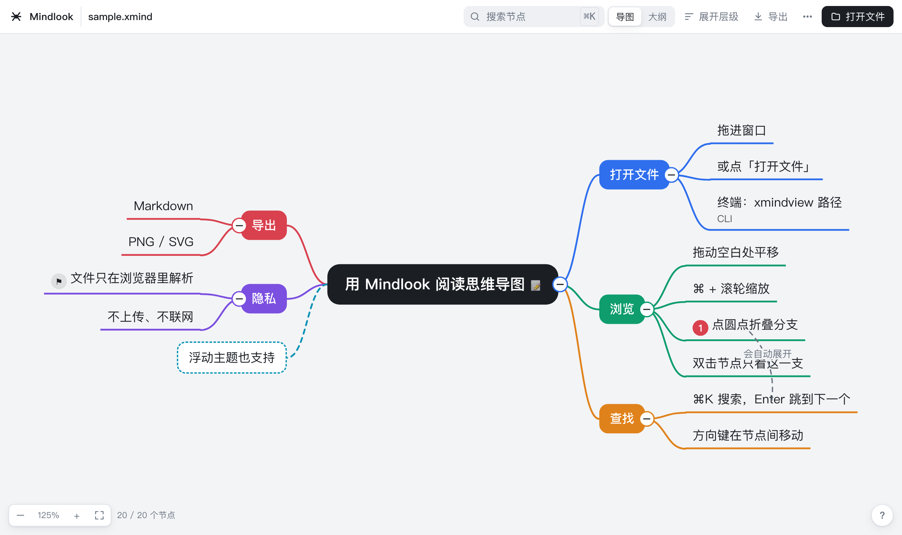

# Mindlook

不装 XMind 也能查看 `.xmind` 思维导图。单个 HTML 文件，零依赖，文件只在浏览器本地解析，不上传。

[English](#english) · 中文



在线试用：**https://caiqianha.github.io/mindlook/**（仓库自带 `samples/sample.xmind` 可以拿来试）

## 特点

- **零依赖、离线可用**：一个 `index.html` 就是全部，用浏览器原生接口解压，没有任何外部脚本
- **两种格式**：XMind 2020+（content.json）和 XMind 8（content.xml）
- **结构类型**：思维导图、逻辑图、树形图、组织结构图、时间轴，按文件里每个节点自己的结构设置来排布
- **完整展示**：多画布、富文本备注（加粗、列表、链接、图片）、标签、超链接、图片、标记、浮动主题、关系线、外框、概要
- **阅读工具**：搜索（⌘K）、按层级展开、双击聚焦某一分支、方向键在节点间移动、大纲视图
- **导出**：Markdown（复制或下载）、PNG、SVG
- **界面**：浅色 / 深色跟随系统，中英文，手机上也能用，首次使用有操作提示，按 `?` 看快捷键
- **命令行**：复制文件路径，一条命令在浏览器打开

## 使用

### 网页

双击打开 `index.html`，把 `.xmind` 文件拖进去，或点「打开文件」。
也可以部署到任何静态托管（GitHub Pages 等），用户直接访问网址即可。

需要 Chrome 103+ / Edge 103+ / Safari 16.4+ / Firefox 113+。

### 命令行（macOS / Linux，需要 Python 3）

```bash
# 加一个别名（写进 ~/.zshrc 或 ~/.bashrc）
alias xmindview='python3 -I /path/to/mindlook/xmindview.py'

xmindview 文件.xmind                 # 生成网页并用默认浏览器打开
xmindview --no-open 文件.xmind       # 只生成，打印路径
xmindview -o 输出.html 文件.xmind    # 指定输出位置（可分享给别人，单文件自带数据）
```

生成的 HTML 已内嵌导图数据和图片，拷给没有 XMind 的同事也能直接打开。

## 快捷键

| 操作 | 按键 |
|---|---|
| 搜索 | `⌘K` 或 `/`，`Enter` 下一个，`Shift+Enter` 上一个 |
| 缩放 / 适应窗口 | `+` `−` / `0` 或 `F` |
| 展开到第 1/2/3 级 / 全部 | `1` `2` `3` / `A` |
| 导图 / 大纲切换 | `O` |
| 节点间移动 / 折叠 | 方向键 / 空格 |
| 聚焦某一分支 / 返回 | 双击节点 / `Esc` |
| 帮助 | `?` |

## 已知限制

- 设置了密码的文件无法打开（需在 XMind 中先解除密码）
- 鱼骨图、矩阵按逻辑图/树形图近似显示；标注（callout）暂不显示
- 不沿用文件里的节点颜色和主题，统一用 Mindlook 配色
- 不支持编辑

## 项目结构

```
index.html        查看器本体（也是命令行的模板）
xmindview.py      命令行：解析 .xmind，内嵌数据生成 HTML 并打开
xmindview         shell 包装
samples/          示例 .xmind 文件
docs/             README 用到的截图
```

## 许可

MIT。Mindlook 与 XMind Ltd. 无关，XMind 是 XMind Ltd. 的商标。

---

## English

View `.xmind` mind maps without installing XMind. A single HTML file, zero dependencies, parsed entirely in your browser. Nothing is uploaded.

**Features**: both XMind 2020+ and XMind 8 formats · map, logic, tree, org-chart and timeline structures · sheets, rich-text notes, labels, links, images, markers, floating topics, relationships, boundaries, summaries · search (⌘K), expand by level, focus a branch, keyboard navigation, outline view · export Markdown / PNG / SVG · light & dark, Chinese & English, mobile friendly · CLI: `xmindview file.xmind` opens it in your browser.

**Use**: open `index.html` and drop a file in (try `samples/sample.xmind`), or deploy it anywhere static. Needs Chrome 103+ / Safari 16.4+ / Firefox 113+.

**CLI**: `alias xmindview='python3 -I /path/to/mindlook/xmindview.py'` then `xmindview file.xmind`. Use `-o out.html` to produce a self-contained page you can share.

MIT licensed. Not affiliated with XMind Ltd.; XMind is a trademark of XMind Ltd.
